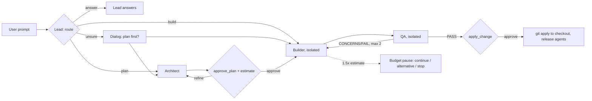

# Plan: orchestrator mode (Lead, Architect, Builder, QA, Guardian)

## Goal

A per-session switch `/orchestrate on|off|status`. While it is on, the main session acts as the **Lead**
(orchestrator) and never edits files itself. For every user prompt the Lead first decides the route:
answer directly, build directly, plan first, or (when unsure) ask the user whether to plan. Planning runs
in an **Architect** subagent, implementation in a **Builder** subagent working in an isolated workspace,
and an independent **QA** subagent checks every Builder result before the user approves applying it to
the checkout. Each run is costed and its quality measured, and both land in the usage tracker, so model,
prompt and threshold choices can be optimised from data.

Terminology: omp is the **harness** (agent loop, tools, context, subagents, isolation). This work is an
**orchestration layer** on top of it, combining the routing, orchestrator-workers and evaluator-optimizer
workflow patterns (<https://www.anthropic.com/engineering/building-effective-agents>), plus an
observability and evaluation part (Guardian).

## Decisions (2026-11-14)

- **Two extensions; the switch touches only one** (user requirement: off = today's behaviour, except
  Guardian and loop protection).
  - `extensions/guardian/`, **always on**: meter (cost per agent and role, waste signals), ledger records
    synced to the usage tracker, agent-level loop breakers, the Guardian auditor, `/orchestrate-retro`.
    With the switch off it records every user prompt as a turn record (`mode: off`) and is otherwise
    invisible (the footer shows `orch: off`, see "Switch in the footer").
  - `extensions/orchestrator/`, **switchable**: Lead persona, `route`, Architect/Builder/QA, spawn gate,
    edit guard, isolation overrides, `apply_change`, cost dialog and pause, Builder/QA, replan and PR round
    caps. Off: its tools are removed from the active tool set (`pi.setActiveTools`), isolation overrides
    are cleared, `planner`/`implementer`/`qa` are disabled through a `task.disabledAgents` runtime
    override (hidden from the `task` description), quick-review and agent-mode run as today.
  - Verified per build: RPC `get_state` `systemPrompt`, tool names and the `task` description with the
    switch off equal the guardian-only baseline (phase 2).
- **Off-mode audit** (user choice: batch at retro): no audit turn in normal sessions; `/orchestrate-retro`
  audits the 10 most expensive unaudited turn records, showing a cost cap before it starts. Rejected: an
  automatic audit after every prompt over $5 (needs a visible extra turn: an extension cannot spawn a
  subagent itself, and `ctx.runEphemeralTurn` runs the main model over the whole conversation); never
  auditing off-mode sessions (they carry 91-94 % of spend).
- **Who decides plan or build**: the Lead, as the first step of its own turn, through a `route` tool
  (`answer | quick | build | plan | unsure`); `unsure` opens a dialog in the tool. No extra model request.
  Rejected: separate classifier model in the `input` hook (extra request per prompt, second opinion the
  Lead can contradict, no documented surface to call another model); keyword/length heuristic (misses
  vague requests, fires on long precise instructions).
- **Switch default**: off in every new session; state saved with the session.
- **Implementation always runs in a subagent**, including one-line fixes (user requirement).
- **Subagents do not spawn subagents** (`spawns: ""`); every extra agent goes through the Lead and the user.
- **Builder isolation**: omp built-in task isolation, patch mode, `apply=false`. While the switch is on,
  the extension sets runtime overrides `task.isolation.enabled=true`, `task.isolation.merge=patch`,
  `task.isolation.apply=false` and forces `isolated: true` on every `implementer` and `qa` spawn
  (`tool_call` input revision on `task`). The patch reaches the checkout only through `apply_change`,
  after QA PASS and user approval; nothing is committed.
  Rejected: `apply=true` (unreviewed change lands in the checkout, mixed with other sessions' edits);
  own `git worktree` per Builder (task tool has no `cwd`, so path discipline would be prompt-only; Builder
  would commit; duplicates omp's workspace lifecycle).
- **QA**: a separate read-only `qa` subagent per Builder round where the QA policy (below) requires it,
  free (no approval dialog). It applies the
  Builder's patch in its own isolated workspace, runs the tests, and checks the change against
  `prompts/quick-review.md` and the plan's acceptance criteria; verdict PASS / CONCERNS / FAIL. Findings
  go back to the **same Builder** via `write agent://<id>` (phase 0b: a finished isolated agent can be
  messaged; it resumes in its retained workspace with its context). After two rounds without PASS the
  Lead asks the user.
  Rejected: Builder self-check (same model grades its own work, same blind spots); existing quick-review in
  the Lead (reviews after the change is applied and the Lead cannot fix).
- **Lanes** (2026-11-14, second round): `quick` = clear request, no design choice, about 3 files at most
  (typo, rename, small fix, PR review threads): one isolated Builder on Sonnet `thinking-level: low`, no
  Architect, no cost dialog, no Guardian (meter only), budget default $5 (setting, retro-tuned), pause
  past it. `build` = clear but larger: Builder, QA, Guardian. `plan` = unclear, several approaches or more
  than about 3 files: Architect, then as `build`.
- **QA policy** (user choice: risk-based). `build` and `plan` runs always get QA. `quick` runs and PR
  fix rounds skip QA unless a trigger fires: diff over 40 changed lines, a test deleted or an assertion
  weakened, or a path touching auth, money, persistence or migrations (meter checks the round patch).
  Without QA the Builder must, in its own workspace: run the narrowest relevant tests, run the repo's
  linters on the changed files (`.golangci.yml`, `pyproject.toml` Ruff, ESLint, `dev/check` when present),
  add tests for new behaviour (AGENTS.md "New code is tested by default"), and check its diff against
  `prompts/quick-review.md`. Its output lists the commands and results; a missing test or lint run counts
  as a trigger. Coverage and duplication gates (G-15 CRAP/Sonar, G-18 dryer) run once before push, not
  per round: QA (or the Builder in a PR round) runs them on the final patch.
  Rejected: light QA on Haiku (still pays an agent start and a test run where Copilot reviews again within
  minutes; weakest on the risky cases the triggers send to full QA); full QA every round (costs about as
  much as a typo fix itself).
- **PR review rounds**: the jflow watcher's follow-up prompt (open threads) reaches the Lead, which routes
  it as `quick` with all threads of the round in one Builder. After `apply_change` the Lead calls
  `jflow_commit` and `review_resolve` (not blocked by the edit guard; commit approval unchanged); the
  watcher restarts. The Builder is released after each round (its workspace base is stale after the
  commit). A thread asking for a design change triggers the replan dialog.
- **PR rounds without jflow** (jflow not on PATH or unreachable: no `jflow_*` tools are registered): the
  user starts a round ("fix the review comments on PR #N" or `/orchestrate pr <N>`); the Lead reads the
  unresolved threads with GitHub MCP `pull_request_read` and routes them as with jflow. Commit and push
  go through the Lead's allowlisted bash (below), so `git-gate` and `push-gate` apply unchanged; replies
  via GitHub MCP `add_reply_to_pull_request_comment`. No own watcher: re-implementing jflow's poller
  (Copilot, Sonar, Teams) duplicates jflow; without it the user triggers the next round.
- **Loop breakers** (deterministic extension code, never a model judgement; user choice: they stay active
  with `budget off`). Each break opens one dialog (another round / accept with known findings / replan /
  stop, patch kept) and is recorded in `loopBreaks[]`.
  - Inside an agent (guardian extension, always on, every session and subagent): a tool call identical in
    name, arguments **and result** to an earlier one gets a note the third time and is blocked the fifth
    (a re-read after an edit returns a different result and does not count; `wait`, `todo`, `ask`
    excluded); per-role `task.agentSoftRequestBudget` runtime override (implementer 150, qa 80, planner
    80, guardian 40), which omp force-stops at 1.5x.
  - Builder and QA: at most 2 fix rounds; stop earlier on no progress: round patch identical to the
    previous one, a QA finding fingerprint (file + normalised text) repeating, the same failing test twice,
    or a resolved finding returning (fix A broke B).
  - Replanning: at most 2 replans per run.
  - PR rounds: at most 3 per PR in orchestrator mode (jflow allows 10); a round that does not reduce the
    open threads counts as no progress; for LOW/nit threads the Lead may propose "reply without change"
    for user approval.
  - Cost: pause at 1.5x the estimate (budget on only).
- **Scope growth and replanning**: three triggers, one dialog. (1) Builder persona rule: stop when the
  change needs files or a design decision outside the assignment, or looks like more than 2x the expected
  work; yield `status: needs_replan` with findings, work done (patch kept) and proposed scope. (2) Meter:
  `quick` run past 3 changed files or its budget pauses; `build` run touching files outside the plan's
  list is flagged. (3) A user answer to a subagent question changes scope. Subagents never ask the user
  directly (`ask` needs an interactive UI; not observed in subagents); they return `questions[]` and the
  Lead asks one at a time (G-14). The Lead offers: replan (Architect gets the findings and the partial
  patch; the new plan says which done steps stay), expand scope (same Builder, new estimate, cost dialog
  above the threshold), stop (patch kept). Every transition is recorded in `replans[]`.
- **quick-review stands down** in the Lead session and in `implementer`/`qa` sessions while the switch is
  on; QA replaces it there. Outside orchestrator mode nothing changes.
- **Cost unit**: API-equivalent USD (`usage.cost.total` per assistant message); tokens shown for
  information only. Rejected: raw tokens (dominated by cache reads, misjudge spend up to 10x); share of the
  5-hour limit (formula unpublished, cannot be estimated up front).
- **Cost gate**: ask before building when the Architect's run estimate (Architect + Builder + QA) exceeds
  **$50** (user choice; about 25 % of a 5-hour window). Builder pauses at **1.5x** its approved estimate.
  Both are settings; the retro proposes changes from recorded accuracy.
- **No-ask mode**: `/orchestrate budget off|on`, saved with the session: no cost dialog, no cost pause;
  estimates are still shown and recorded. Loop breakers stay active (user choice: they fire only on no
  progress, which unlimited budget does not fix).
- **Bookkeeping**: one source, the session logs. Run and turn records via `pi.appendEntry("guardian-run", …)`;
  the usage parser joins them with measured cost per session and subagent; `collect.mjs` syncs them to the
  `agent-usage` repo; `usage_report` groups by `run`, `route`, `role`. Quality signals are captured
  without asking; `/orchestrate rate 1-5 [note]` adds an optional user rating.
- **Work items** (user requirement: a Jira key or GitHub issue is always part of the tracking). Every run
  and turn record carries `workItems[{ id, kind: jira|github-issue|github-pr, source, primary }]`, switch
  on or off (the guardian extension writes them). Sources, in precedence order for `primary`:
  1. explicit: `/track <id>` (session-wide until `/track off`);
  2. git branch of the repository the prompt works in (`git branch --show-current`, read at prompt
     start; jflow branches carry the Jira key);
  3. PR round: the PR number (jflow watcher or manual round) and its repo;
  4. prompt text: GitHub issue/PR URLs, `owner/repo#N`, `issue://N`, `pr://N`, and Jira keys.
  Jira key false positives (`UTF-8`, `SHA-256`, `ISO-8601`, `CVE-…`): a key in prompt text counts only
  when its project prefix is known, i.e. seen in a branch name or listed in the guardian setting
  `jiraProjects`; branch and explicit keys always count and teach the prefix. A run keeps every id found
  (secondary ones without `primary`), so "like in ABC-12" stays visible but does not take the cost.
  Hourly rows stay unchanged (no `rowKey` change); reports join cost to work items through the run
  records. Backfill: the parser applies the prompt-text rule to old sessions (branches are not in old
  logs). Jira keys and issue numbers in `agent-usage` fall under the policy risk the user accepted in the
  usage tracker spec (titles with Jira keys).
- **Guardian outputs** (user choice: human view as HTML inside the existing usage reports).
  - Machine: JSONL in `agent-usage/devices/<device>/{runs,findings,improvements}/<YYYY-MM-DD>.jsonl`,
    each device writing only its own directory (no merge conflicts), latest line per id wins. Read
    through `usage_report` with `view: hourly|runs|findings|improvements`, not a second tool.
  - Evidence policy: findings carry references only (`file:line`, agent id, tool call index) plus one
    sentence; never quoted code or tool output; free text passes the secret redactor. Reason: work
    repositories' client code must not reach the personal `agent-usage` repo (`client-ip-check` risk).
  - Human, in session: a run summary card at run end (custom message, no model turn): lane, cost per role
    against the estimate, QA verdict, loop breaks, new findings; `/orchestrate status` shows the current run.
  - Human, reports: a **Pipeline** section in the daily/weekly/monthly/yearly/all-time pages (runs by
    lane and mode, cost per role, estimate ratio, QA first-pass rate, loop breaks, top waste signals, open
    findings, improvements of the period) and an improvement log page `reports/guardian/index.html`,
    linked from `reports/index.html`.
  Rejected: Markdown logs (second renderer for the same data, pipeline figures apart from the cost charts);
  both formats (every figure maintained twice).
- **Guardian** (user choice: post-run auditor). Three layers, all writing to the ledger:
  1. *Meter* (extension code, every agent of a run, no model): cost per agent and role, budget pause, and
     waste signals: repeated reads of the same file (3+), repeated identical commands (e.g. full test
     reruns), failed tool calls, edit retries, QA rounds, idle/wait time. A third identical tool call gets
     a one-line `additionalContext` note to that agent.
  2. *Run auditor* (`guardian` subagent, Sonnet, `thinking-level: low`, free, spawned by the Lead after
     every run with route `plan` or `build`, after apply or stop): reads the run digest (meter signals,
     QA verdicts, user decisions) and the run agents' `history://` transcripts; returns findings with
     evidence in two scopes, `pipeline` (persona prompts, model/thinking per role, estimate accuracy, gate
     behaviour) and `task` (the `prompts/retro.md` categories: navigation, missing checks, unclear steering
     files, wasteful tool use, missing access). Read-only; changes nothing. Estimated $0.20-0.40 per run.
  3. *Improvement loop* (`/orchestrate-retro`): groups findings across runs, ranks by cost x recurrence,
     proposes changes one at a time (G-14). Every run record carries `pipelineVersion` (hash of the
     persona files and orchestrator settings) so a change is judged by before/after cost, QA first-pass
     rate and rating. The guardian extension notifies once per session start (switch on or off) when 10 or
     more unreviewed findings exist or the last retro is older than 7 days.
  Rejected: omp live advisor (`WATCHDOG.yml`) on every turn (estimated +20-50 % cost per run, subagent
  coverage unverified, in-run steering already covered by meter, pause and QA); no model at all (task and
  steering-file findings need judgement over transcripts).
- **Following builders**: omp Agent Hub (`Alt+A`: roster with status, current tool, tokens, cost; `Enter`
  to focus and steer; `x` to kill), pinned Subagents block with `display.subagentLivePreview: true`, and a
  footer segment `orch: <route> · <role> $<actual> / est $<estimate>`. No custom viewer.
- **Switch in the footer** (user requirement): the switch state is always visible, also when off:
  `orch: off` (dim), `orch: on` / `orch: on · budget off` (orange). Under omp it is drawn in
  lean-footer's widget below the editor (omp drops the status segment on narrow terminals); the
  orchestrator sends it on `pi.events` channel `orchestrator:footer`. Under pi it is the orchestrator's
  `setStatus` text. This is the one visible difference of the switch-off state.
- **Plan storage**: the Architect writes `local://plan.md`; on approval the Lead offers to store it as a
  spec in `notes/specs/` (plan skill, section 5).

## Research: how other harnesses decide (checked 2026-11-14)

| Harness | Who decides "plan first?" | Where planning runs | User gates |
|---|---|---|---|
| Claude Code | Acting model calls `EnterPlanMode` (no parameters; "err on the side of planning", more than 2-3 files, several valid approaches) | Main session in read-only plan mode; `Plan` research subagent | Entering plan mode; the plan via `ExitPlanMode` |
| Cursor | User (Shift+Tab); suggests Plan Mode on keywords indicating complex tasks | Main agent, plan as editable markdown | "Build" click |
| Codex CLI | User (`/plan`, Shift+Tab) | Main session | "Implement this plan?" |
| Roo Code Orchestrator | Orchestrator mode delegates via `new_task` to Architect/Code/Debug modes | Subtasks in isolated contexts; only the completion summary returns | Each subtask creation and completion (default); orchestrator has no read/write by default |
| Kiro | User picks a Vibe or a Spec session | Spec: requirements, design, tasks | Each phase |
| OpenCode | User switches primary agents Build/Plan | Plan agent is read-only | none |
| omp | User: plan mode (`Alt+Shift+P`), `/vibe` director | Plan mode in the main session; vibe workers fixed to bundled `sonic`/`task` | Plan review overlay |

Sources: <https://xilidou.com/2026/08/03/claude-code-tools-enter-plan-mode>,
<https://code.claude.com/docs/en/sub-agents>, <https://cursor.com/docs/agent/plan-mode>,
<https://smartscope.blog/en/generative-ai/chatgpt/codex-plan-mode-complete-guide/>,
<https://docs.roocode.com/features/boomerang-tasks>, <https://kiro.dev/docs/specs>,
<https://opencode.ai/docs/agents/>, `omp://vibe-mode.md`.

No harness runs a separate classifier model per prompt for this decision. The design takes Claude Code's
gate (acting model decides, conservative bias) and Roo's orchestrator/subagent split with per-subtask
approval, built on omp hooks.

## Baseline cost data (usage_report, last 14 days, 2026-11-14)

- Implementation subagents (`LG*`, `I*`, `PersonaDay228`): $6-55 each, typically $13-25 API-equivalent.
- Scouts and mapping agents: $2-5.
- $1 is about 0.4-0.6 % of a 5-hour window (a full window about $170-245).
- Main sessions carry 91-94 % of spend; orchestrator mode moves that work into attributable roles.

## Facts the design rests on (omp docs, 2026-11-14)

- `before_agent_start` (`reason: "prompt"`) can replace the system prompt per prompt; it also fires with
  `reason: "revive"` for parked subagents, which must return early.
- `ctx.agent.kind` is `"main"` or `"sub"`, `ctx.agent.name` the agent definition name; extension factories
  are rebound to every subagent session.
- `tool_call` can block a call or revise its input (revalidated); fail-closed on error or timeout.
- `before_subagent_spawn` fires in the parent once per child with `agent`, `invocationKind`, `spawnKey`;
  returns `{ block, reason }`.
- `ctx.sessionModes.getState()` reports omp plan, vibe, goal and loop modes (TUI only).
- Runtime setting overrides: `lookup(id).override(pi.pi.settings, value)` from
  `@oh-my-pi/pi-coding-agent/config/registry`; never persisted; `clearOverride` restores.
- Task isolation (`omp://tools/task.md`): `isolated: true` per item when `task.isolation.enabled`; patch
  mode writes `<id>.patch`; `apply=false` keeps it unapplied; result details carry `patchPath`,
  `nestedPatchPaths`, `branchName`; kept-alive isolated agents retain the workspace through idle/park and
  release captures and cleans it; the isolation baseline is capped at 1 GiB. Current config: isolation
  off, backend `auto`, merge `patch`, apply `true`; `ovnfs` not on PATH.
- Agent definitions support `structured: true` with an `output` schema (results returned through `yield`).
- `task.softRequestBudget` counts requests, not cost; not used for the cost gate.
- Custom agents are discovered from `<extension-root>/agents/*.md`, i.e. `my-pi/agents/`.
- MCP tools are called through `write xd://<tool>`, so the Lead keeps `write` for `xd://`.
- Session logs carry `usage.cost.total` per assistant message; subagent logs live in
  `<session>/<Name>.jsonl` (usage tracker spec).

## Approach

### Extension `extensions/orchestrator/`

- **State** (saved via `pi.appendEntry("orchestrator", …)`, restored on `session_start`): `enabled`,
  `budget` (`on|off`), and the current run: `runId`, `route`, `planApproved`, `estimate`, spawned agents
  with roles, QA rounds, pending patch. The run resets on `before_agent_start` with `reason: "prompt"` in
  the main session.
- **Lead persona**: fixed text in `extensions/orchestrator/lead.md`, appended to the system prompt for
  `ctx.agent.kind === "main"` while enabled.
- **Tools** (refused while off):
  - `route({ route, reason })`: `unsure` opens `ctx.ui.select` "Plan first (recommended) / Quick change /
    Build directly"; a later call in the same run with a new route is a replan transition (recorded).
  - `approve_plan({ path, summary, estimateUsd })`: approve / refine (feedback) / stop; when budget is on
    and the estimate exceeds the threshold, the dialog shows the estimate per phase.
  - `request_agents({ agent, count, purpose })`: confirm dialog; approval raises the extra quota.
  - `apply_change({ agentId })`: shows QA verdict and diffstat, confirm, then `git apply --check` and
    `git apply` of the captured root patch in the checkout; refuses nested patches (lists them) and a
    failing check (keeps the patch, reports its path); on success releases the run's Builder and QA.
  - `budget_decision`: not a tool; the Lead asks via `ctx.ui.select` in the budget-pause flow below.
- **Spawn gate** (`before_subagent_spawn`, main session, enabled): block before `route`; one free
  `planner` on route `plan` (and one more per replan); one free `implementer` on route `quick` or `build`
  or after plan approval (and after the cost dialog when required); one free `qa` per Builder round when
  the QA policy requires it; one free `guardian` per finished plan/build run; messaging an existing agent
  is not a spawn; everything else needs `request_agents`.
- **Isolation**: runtime overrides set on `/orchestrate on`, cleared on `off`; a `tool_call` revision on
  `task` sets `isolated: true` for `implementer` and `qa` items. omp writes `<artifacts>/<agentId>.patch`
  only at the first completion and again at release, so it is stale after a follow-up turn (phase 0b).
  The extension therefore writes its own **round patch** in the Builder session: at `session_start` it
  records the baseline tree of the workspace (`git add -A` + `git write-tree` with a temporary
  `GIT_INDEX_FILE`, so the workspace index is untouched and the user's uncommitted changes copied into
  the baseline are excluded); when the Builder calls `yield` it writes
  `<artifacts>/<agentId>.round-<n>.patch` = `git diff --binary <baseline>` of the current tree (same
  temporary index). QA applies the latest round patch; `apply_change` applies exactly the bytes QA
  passed. `<artifacts>` is the session file without `.jsonl`; the agent id is the `spawnKey`.
- **Edit guard** (`tool_call`): Lead while enabled blocks `edit`, `ast_edit`, `eval`, `write` except
  `xd://`, `local://`, `out://`, `agent://`, `proc://…/kill`, and `bash` except an allowlist: `git
  status|diff|log|show|fetch|commit|push` and the gate commands of `agents/quality-gates.md` (`crapper`,
  `dryer`, the coverage command). push-gate counts gate runs only in the same session and repository on
  the pushed content, so the Lead runs the gates in the checkout after `apply_change`; `git-gate` and
  `push-gate` work unchanged. `planner` may `write` only `local://`. `qa` may not `edit`, `ast_edit` or
  `write` (bash allowed for tests and `git apply` in its workspace).
- **Cost meter and Builder pause**: in `implementer` sessions the extension sums `usage.cost.total` of
  each assistant message (`message_end`). Past 1.5x the approved estimate, with budget on, `tool_call`
  blocks every tool except the final `yield`, with a reason telling the Builder to yield status `paused`:
  done, open, alternatives (cheaper path, reduced scope, stop), estimated remaining cost. The Lead shows
  the user continue (new budget) / take alternative / stop, then steers the same Builder via
  `write agent://<id>`. Without a plan (route `build`), the estimate is the threshold. Budgets reach the
  Builder session through a `globalThis` registry keyed by agent id (phase 0: module state is re-evaluated
  per session, `globalThis` is shared in-process).
- **Cleanup**: an isolated workspace (`~/.omp/wt/<hash>/m`, owner file `.omp-isolation-owner.json` with
  `{ pid, id }`) lives until the agent is released; it survives idle, parking and process exit (phase 0b).
  Release = `write proc://<id>/kill` (captures the final cumulative patch, removes the workspace). The Lead
  releases Builder and QA after `apply_change` or stop (persona rule; `apply_change` and the stop dialog
  name the ids to release in their result). On `/orchestrate off` the extension tells the Lead to release
  the run's agents. At `session_start` the extension lists `~/.omp/wt/*` whose owner `pid` is no longer
  running and offers to delete them (confirm dialog). Round patches stay in the artifacts dir.
- **Mode conflict**: `/orchestrate on` is refused while omp plan or vibe mode is active.
- **quick-review**: `extensions/quick-review` skips its `agent_end`, `before_agent_start` self-review and
  `tool_call` tracking when orchestrator mode is on in the Lead, and in `implementer`/`qa` sessions
  (shared predicate exported by the orchestrator state module).

### Agent files in `my-pi/agents/`

All four: `spawns: ""`, `structured: true` with an `output` schema.

- `planner.md` (Architect): tools `read, grep, glob, lsp, web_search, write`; `autoload-skills: plan`;
  Opus family, `thinking-level: high`. Output: `{ planPath, phases[{ title, estimateUsd }], estimateUsd,
  openQuestions[] }`. The prompt contains the last estimate-accuracy ratios from the ledger.
- `implementer.md` (Builder): default tools; `autoload-skills: build`; Sonnet family,
  `thinking-level: medium` (`low` on route `quick`, set per spawn); never commits. Output: `{ status:
  done|paused|needs_replan|failed, done[], open[], alternatives[], remainingUsd, filesChanged[],
  testsRun{ command, passed, failed }, lintRun{ command, passed }, questions[], proposedScope? }`.
- `qa.md` (QA): tools `read, grep, glob, lsp, bash`; Sonnet family, `thinking-level: medium`. Applies the
  Builder patch in its workspace, runs tests, applies `prompts/quick-review.md` checklist and the plan's
  acceptance criteria. Output: `{ verdict: PASS|CONCERNS|FAIL, findings[{ severity, file, line, text }],
  testsRun{ command, passed, failed }, acceptance[{ criterion, met }] }`.
- `guardian.md` (Guardian run auditor): tools `read, grep, glob`; Sonnet family, `thinking-level: low`.
  Input: run digest file in the session artifacts directory, the run's agent ids. Output: `{ runIds[], findings[{ scope:
  pipeline|task, category, severity, evidence, suggestion, estSavingUsd? }], runSummary }`.

Model selectors (role alias vs id) are settled in phase 2 against `omp://task-agent-discovery.md`.

### Ledger and optimisation

Run record (`guardian-run`, one per orchestrated run or, with the switch off, per user prompt; rewritten on
each transition; latest wins; `mode: off|orchestrated`):
`runId`, `sessionId`, `startedAt`, `endedAt`, `route`, `routeReason`, `unsureAsked`, `agents[{ id, role,
model }]`, `estimate{ totalUsd, phases[] }`, `costGateAsked`, `planRevisions`, `qaRounds[{ verdict,
findingsBySeverity }]`, `testsRun`, `budgetPauses[{ atUsd, decision }]`, `userDecisions[]`, `outcome:
applied|stopped|failed|answered`, `rating?`, `ratingNote?`, `pipelineVersion`, `waste{ repeatedReads,
repeatedCommands, failedTools, editRetries, waitMs }`, `perAgent[{ id, role, costUsd, requests }]`,
`guardianFindings[]`, `findingsReviewed`, `lane`, `qaSkipped{ reason }`, `qaTriggers[]`, `replans[{ from,
to, trigger: builder|meter|user, reason }]`, `prRound?{ repo, pr, threads, source: jflow|manual }`,
`loopBreaks[{ level, reason, decision }]`, `workItems[{ id, kind, source, primary }]`, `branch`.

- Parser (`extensions/usage/parse.mjs`): reads `guardian-run` entries; latest per `runId`; findings from
  each run's `guardianFindings[]`.
- Store (`store.mjs`): `writeRuns`, `writeFindings`, `writeImprovements` to
  `devices/<device>/{runs,findings,improvements}/<YYYY-MM-DD>.jsonl`, merge by `runId` / finding `id` /
  improvement `id`; free text (`routeReason`, `ratingNote`, evidence, suggestion, reason) redacted.
- Finding row: `id` (fingerprint of scope, category, file, normalised text), `runId`, `sessionId`,
  `project`, `pipelineVersion`, `scope`, `category`, `severity`, `evidence`, `suggestion`, `estSavingUsd`,
  `status: open|accepted|rejected|applied|obsolete`, `updatedAt`, `workItems[]` (copied from the run).
  Recurrence = number of runs with the same `id`.
- Improvement row: `id`, `date`, `findingIds[]`, `change{ files[], settings[], summary }`, `scope`,
  `project?` (task-scope changes such as an AGENTS.md edit in a repository), `pipelineVersionBefore`,
  `pipelineVersionAfter`, `decision: applied|rejected|deferred`, `reason`. The effect is computed at report
  time, never stored: pipeline scope compares runs by `pipelineVersion`, task scope compares runs of the
  project before and after `date`; fewer than 5 runs on either side shows "not enough data".
- Collector (`collect.mjs`): writes runs, findings and improvements with the hourly rows.
- Report (`report.mjs`): `groupBy` gains `run`, `route`, `role`, `mode`, `pipelineVersion`, `workItem`
  (primary id; cost of turns without one shows as "no work item"); `view` selects
  hourly rows, runs, findings or improvements; cost per run is the sum of the run's agents' rows
  (subagent name + session) plus the Lead's requests between run start and end. A runs table adds
  estimate, actual, ratio, QA first-pass, rounds, tests, outcome, rating.
- Pages (`digest.mjs`, `page.mjs`): Pipeline section per period; `reports/guardian/index.html` with the
  improvement log (date, change, findings that led to it, measured effect, decision) and the open findings
  ranked by cost x recurrence; a "Work items" table per period (cost, runs, lanes, QA first-pass, open
  findings per primary id); runs, findings and improvements enter `inputHash`; `REPORT_VERSION` bumped.
- `prompts/orchestrate-retro.md`: reads `usage_report` over runs and the Guardian findings, groups them
  by category, ranks by cost x recurrence, compares `pipelineVersion` before/after, and proposes changes
  (model and thinking per role, persona prompts, skills, steering files, threshold, pause factor) one at a
  time with evidence; changes nothing without approval (G-14); writes each decision as an improvement row
  and updates the status of the findings it covers.

## Phases

- [x] **Phase 0: probes** (throwaway extension `/tmp/probe-orch`, `omp --mode rpc`, Haiku, 2026-11-14)
  - Module state is **not** shared: the extension module is re-evaluated for every subagent session
    (fresh closure, `ctx.agent = { kind: "sub", id: "<AgentId>", name: "<agent>", depth: 1,
    parentId: "Main" }`). `globalThis` **is** shared (same process; worker threads start only at 9+
    concurrent subagents).
  - Runtime overrides via `lookup(id).override(pi.pi.settings, v)` work in the factory
    (`provenance: runtime`).
  - A `tool_call` revision adding `isolated: true` to each `task` item is accepted; the child ran in
    `~/.omp/wt/<hash>/m` (owner file `.omp-isolation-owner.json`).
  - The async `task` call's own `tool_result` returns at once (`async.state: running`); completion arrives
    later through `wait`/async delivery with a merge summary: `Isolation: changes captured at
    <artifacts>/<AgentId>.patch (apply=false). Not applied.` and "ran isolated and cannot be resumed or
    messaged". Structured output is written to `<artifacts>/<AgentId>.json`.
  - `before_subagent_spawn` carries `{ agent, invocationKind: "task", spawnKey: "<AgentId>" }`;
    `ctx.ui.confirm` inside it works over RPC.
  - Parent extension handlers run in subagent sessions (`tool_call`, `message_end` with
    `usage.cost.total`), so guards and the cost meter work there.
  - Agents from a package `agents/` dir are discovered (`agentSource: user`); `structured: true` with a
    YAML `output` JSON schema validated ("schema valid").
  - Follow-up runs (phase 0b, same day): the "cannot be resumed or messaged" text is stale (documented in
    `omp://tools/task.md`). `write agent://<id>` to a finished isolated agent returned "Delivered", the
    agent resumed in the same workspace with its context and made a second edit. The `.patch` file kept
    the first turn's diff only. `write proc://<id>/kill` ("killed session, dropped registration") rewrote
    the patch with both turns and removed the workspace. Without a kill, workspaces stayed in `~/.omp/wt`
    after the omp process exited (two orphans from these probes, deleted by hand).
  - Design adjustments: steer the same Builder; extension-written round patches; budgets via
    `globalThis`; the Lead releases agents with `proc://<id>/kill`; orphan workspaces reported at start.
- [x] **Phase 1: Guardian core (always on)**
  - Files: `extensions/guardian/{meter.mjs,meter.test.mjs,workitems.mjs,workitems.test.mjs,index.ts}`,
    `package.json`.
  - Change: meter (cost per agent and role from `message_end`, waste signals), turn records
    (`guardian-run` entries, `mode: off|orchestrated`, `workItems`, `branch`) via `appendEntry`, identical
    call+result loop breaker, `globalThis` registry for budgets shared with subagent sessions, `/track
    <id>|off|status`, learned Jira prefixes in `~/.omp/agent/guardian-state.json`.
  - Tests: cost summed per agent; repeated read/command counters; note at 3 and block at 5 identical
    call+result; a changed result resets the count; `wait`/`todo`/`ask` never counted; work items:
    precedence explicit > branch > PR > prompt, `UTF-8`/`SHA-256`/`CVE-2024-1` ignored, unknown prefix in
    prompt ignored until seen in a branch, GitHub URL/`owner/repo#N`/`issue://N` parsed, several ids kept
    with one primary.
  - Verify: `node --test extensions/guardian/`; RPC run: turn record written, `get_state` `dumpTools`
    unchanged against today.
  - Risk: low-medium (false positives of the loop breaker; covered by the result-equality rule).
  - Done 2026-11-14. Adjustments: the cross-session registry and run record builder live in
    `extensions/guardian/registry.mjs` (+ test); the registry holds subagent meters now, budgets join it
    in phase 5. Bash results ignore `Wall time:` lines for the loop fingerprint. Verified: 23 unit tests;
    RPC (Haiku, scratch repo on branch `ABC-12-guardian`) with and without the guardian: same 11 tools,
    identical system prompt; one `guardian-run` entry with work items `ABC-12` (branch, primary) and
    `acme/api#7` (prompt), per-agent cost Main $0.071427 / subagent $0.044011, equal to the sums of
    `usage.cost.total` in the session and subagent logs.
- [x] **Phase 2: orchestrator switch and personas**
  - Files: `extensions/orchestrator/{state.mjs,state.test.mjs,index.ts,lead.md}`, `agents/planner.md`,
    `agents/implementer.md`, `agents/qa.md`, `package.json`.
  - Change: `/orchestrate on|off|status|budget on|off|rate <1-5> [note]`, save/restore, status line,
    refusal while plan/vibe mode is active, isolation overrides on/off, tools active only while on, Lead
    injection (main only, early return on `revive`).
  - Verify: `node --test extensions/orchestrator/`; RPC `get_state` off equals phase 1 baseline (apart
    from the agent list), on shows the Lead text and tools; check whether agent files can be hidden.
  - Risk: medium (discovery from `my-pi/agents/`, which also holds `AGENTS.md`).
  - Done 2026-11-14. Findings and adjustments:
    - Agent files can be hidden: a runtime override of `task.disabledAgents` (user value plus
      `planner`, `implementer`, `qa`) removes them from the `task` description, applied at load or at
      `session_start`. With the switch off, system prompt, tool names and `task` description equal the
      guardian-only baseline exactly; after `/orchestrate on` they are listed, after `off` hidden again.
    - omp passes `before_agent_start` `systemPrompt` as an array of blocks; the Lead is appended as one
      more block (`appendSystemPrompt`, now `extensions/shared/system-prompt.mjs`). A template string
      joins the array with commas; `extensions/quick-review`'s self-review directive had that bug
      (`</critical>,<project-context>`) and now uses the shared helper (verified over RPC).
    - `implementer` does not autoload the `build` skill: its "pause after each phase" rule contradicts a
      subagent that cannot talk to the user; the persona carries the rules it needs. `planner` autoloads
      `plan` and is told to return questions instead of asking.
    - `testsRun`/`lintRun` are arrays of `{ command, passed, summary }` (several commands per round).
    - Models are pinned ids (`anthropic/claude-opus-5-5`, `anthropic/claude-sonnet-5-5`, each with the
      `-5` fallback); `task.agentModelOverrides` overrides them, the retro tunes them.
    - The quick-review checklist the `qa` and `implementer` personas refer to is appended to their
      system prompts in phase 4; tool activation while on comes with the tools in phase 3.
    - The guardian records `mode: orchestrated` while the switch is on (registry `mode`);
      `/orchestrate rate` appends the rated last run record.
    - Verified: 30 unit tests (guardian, orchestrator); RPC (Haiku) off/on/off with a payload probe:
      the provider request carried the Lead only while on, the on-state prompt equals the baseline plus
      one block.
- [x] **Phase 3: route, approvals, spawn gate, edit guard**
  - Files: `state.mjs` (`decideSpawn`, `guardToolCall`, transitions), `state.test.mjs`, `index.ts`.
  - Tests: spawn blocked before `route`; one free planner on `plan`; implementer blocked until plan
    approval; free implementer on `quick` without plan or cost dialog; cost dialog above threshold and
    skipped with budget off; QA free only when the policy requires it; extra agents only after
    `request_agents`; quotas reset per prompt; a second `route` call records a replan and frees one
    planner; Lead `edit`/`bash` blocked and `write xd://` and `jflow_*` allowed; planner `write` outside
    `local://` blocked; QA `edit` blocked; while off nothing is blocked except spawns of
    `planner`/`implementer`/`qa`.
  - Risk: medium.
  - Done 2026-11-14. Adjustments:
    - Logic in `extensions/orchestrator/gate.mjs` (+ test), not `state.mjs`; the Lead's bash allowlist
      reuses push-gate's `gatesRun`, so it admits exactly the gate commands push-gate counts; a quote-aware
      scan rejects `;`, `&`, `|`, redirects, newlines, backticks and `$(` outside single quotes.
    - The run is not reset per prompt: a user's answer to the Lead is a prompt too and must not cost the
      run its approvals. `route` starts a run; `route` with `replan: true` changes its lane (cap 2).
    - The cost dialog is the plan approval dialog: above $50 (budget on) its title says so.
    - QA is free per Builder round in `build`/`plan` only; the `quick`-lane triggers come in phase 4.
      A Builder round is the first Builder result plus each `write agent://<builder>` (cap 3 rounds).
    - The Lead may not reach `ast_edit`/`debug` through `write xd://`; MCP tools stay allowed.
    - The orchestrator tools are in the active tool list only while on (`setActiveTools`).
    - Switch in the footer (user requirement, same round): `orch: off|on[ · budget off]` in lean-footer's
      widget; quick-review's comma-joined system prompt fixed through `extensions/shared/system-prompt.mjs`.
    - Verified: 42 unit tests (guardian, orchestrator, shared); RPC (Haiku): tools absent while off and
      present while on; Lead `edit` blocked; `task` before `route` refused ("Call route first"); `unsure`
      opened the select; a scout in lane `quick` refused, allowed after `request_agents` confirmed; footer
      widget showed `orch: off` → `orch: on` → `orch: on · budget off` → `orch: off`.
- [x] **Phase 4: isolation, QA loop, apply, cleanup**
  - Files: `state.mjs`, `index.ts`, `extensions/orchestrator/apply.mjs` + test, `extensions/quick-review/`
    (stand-down predicate).
  - Tests: `task` items for implementer/qa get `isolated: true`; QA policy: `quick` without triggers skips
    QA, each trigger (40 lines, deleted test, weakened assertion, risky path, missing test or lint run)
    forces it, `build`/`plan` always QA; QA loop stops after two rounds and asks; `needs_replan` result
    leads to the replan dialog; `apply_change` refuses nested patches and failing `--check`, keeps the
    patch; release after apply/stop; quick-review skips in Lead/implementer/qa while on and runs otherwise.
  - Also: loop breakers (no-progress fingerprints, round and replan caps, PR round cap, identical-call
    block, soft request budget overrides) with tests; Lead bash allowlist with tests (allowed git and gate
    commands; `git checkout`, `rm`, redirects and chained commands blocked); manual PR round without jflow.
  - Verify: `node --test extensions/orchestrator/ extensions/quick-review/`; one RPC run applies a real
    patch in a scratch repo.
  - Risk: medium (patch apply against a moving checkout; covered by `--check`).
  - Done 2026-11-14. Adjustments:
    - New modules: `rounds.mjs` (baseline tree, round patches, QA triggers, no-progress check, orphan
      scan, process-wide registry of rounds and QA reports) and `apply.mjs`; gate additions in `gate.mjs`.
    - Builder and QA results are captured from their `yield` input (`{ data }`) in the subagent
      session; the Lead never handles patch paths: the extension appends the newest round patch to every
      `qa` task.
    - `apply_change` refuses when QA is required (lane `build`/`plan`, or a trigger) and none ran, unless
      `overrideQa: true`; the apply dialog then warns the user, who decides. Nested repository changes
      are refused (apply by hand).
    - Loop breaks open one dialog on the Lead's `write agent://<builder>`: Builder `needs_replan` or
      `paused`, three Builder rounds, identical patch, repeated finding, same failing test, returning
      finding. "Another round" past the cap grants one round and one QA; recorded in `run.loopBreaks`.
    - PR round cap: jflow watcher prompts counted per PR (`prRoundKey`); the fourth round refuses new
      implementers. Manual rounds ("fix the comments on PR #N") are not counted.
    - Per-role soft request budgets as a runtime override of `task.agentSoftRequestBudget` while on,
      merged over the user's own entries.
    - The quick-review checklist is appended to the `implementer` and `qa` system prompts.
    - quick-review stands down in the Lead and the orchestrator agents while the mode is on.
    - Orphaned workspaces (owner pid gone) are offered for deletion at session start (switch on) and at
      `/orchestrate on`; `/orchestrate off` lists the isolated agents to release.
    - Verified: 94 unit tests (orchestrator, guardian, shared, quick-review, lean-footer), including real
      git: a round patch excludes the user's uncommitted edit, applies to a checkout carrying that edit,
      and is refused (checkout unchanged) when the checkout moved. RPC (Haiku Lead, Sonnet Builder, scratch
      repo with an uncommitted user line): route quick → isolated implementer → `round-1.patch` →
      `apply_change` refused (QA required: no tests, no linter) → override → dialog warned → applied
      `begin`, user line kept → `proc://<id>/kill` released the agent. Not run over RPC: the loop-break
      dialog and a QA agent (unit-tested only); Haiku as Lead skipped QA, which the refusal now catches.
- [x] **Phase 5: estimates and budget pause**
  - Files: `extensions/orchestrator/state.mjs` (`pauseDecision`), tests, `index.ts`, `agents/planner.md`
    (accuracy ratios injection), `agents/implementer.md` (paused output); reads the guardian meter.
  - Tests: pause at 1.5x blocks tools except `yield`; no pause with budget off; estimate defaults to the
    threshold without a plan; continue sets a new budget.
  - Risk: medium (estimate quality; tracked by the ledger).
  - Done 2026-11-14. Adjustments:
    - Logic in `gate.mjs` (`builderBudget`, `pauseDecision`, `continueBudget`), not `state.mjs`.
    - Builder budget: approved plan estimate (`approve_plan` `estimateUsd`), $5 in lane `quick`, $50
      for `build` without a plan. Set per Builder id at spawn in the process-wide orchestrator
      registry, with the budget switch, because the pause is enforced in the Builder's own session;
      the cost comes from the guardian meter of that session.
    - Continue after a pause: the existing break dialog (level `budget`) shows spent and budget;
      "Another round" sets spent + the Builder's `remainingUsd` (else + the previous budget).
    - Moved to phase 6: the planner's estimate-accuracy note (needs the ledger's estimate vs actual)
      and the footer segment with lane and cost (needs the run record the ledger builds).
    - Verified: 36 orchestrator unit tests; RPC (Haiku Lead, Sonnet Builder, a probe extension setting a
      $0.001 Builder budget): the Builder's next tool call was blocked with the budget-pause reason, it
      yielded `paused`, the Lead's `write agent://` opened the dialog ("Spent $0.08 of $0.00"), "Another
      round" let the Builder go on in the same workspace and write `round-2.patch`.
- [x] **Phase 6: ledger, Guardian, usage integration, retro**
  - Files: `extensions/usage/{parse,store,collect,report}.mjs` + tests, `extensions/guardian/index.ts`
    (`pipelineVersion`, run digest, retro reminder), `extensions/orchestrator/index.ts` (free `guardian`
    spawn per finished plan/build run), `agents/guardian.md`, `prompts/orchestrate-retro.md` (includes the
    off-mode batch audit: 10 most expensive unaudited turns, cost cap shown first).
  - Tests: parser keeps the latest record per `runId`; store merges runs, findings and improvements by id
    and redacts free text; a finding's quoted code or tool output is stripped to one line of text; improvement effect
    computed by `pipelineVersion` and by project date, "not enough data" under 5 runs per side; Pipeline
    section and `reports/guardian/index.html` render from fixture data; a changed finding status rebuilds
    the affected pages only; run summary card content; report attributes cost to runs and roles,
    computes estimate ratio, QA first-pass rate, groups by `pipelineVersion` and `mode`; one free
    `guardian` per finished plan/build run; reminder fires at 10 unreviewed findings or 7 days; batch
    audit picks the top 10 unaudited turns.
  - Verify: `node --test extensions/usage/ extensions/guardian/ extensions/orchestrator/`; `usage_report` with
    `groupBy: ["run"]` and `view: "findings"` on a real session; pages generated from a copy of the real
    repository and their SVG inspected.
  - Risk: low-medium (attribution of Lead requests to a run by time span).
  - Done 2026-11-14. Adjustments:
    - Findings capture and `guardian_decision` live in the guardian extension, not the orchestrator:
      the retro usually runs with the switch off. The off-mode tool list therefore gains
      `guardian_decision`; the `guardian` agent is not in `ORCHESTRATOR_AGENTS` and stays visible when off.
    - Findings are their own entry (`guardian-findings`, written in the guardian subagent's log from its
      `yield` data, object or JSON string, with `runIds[]`), not `guardianFindings[]` in the run record;
      decisions are `guardian-improvement` entries. The parser collects all three (`ledger`); its
      line pre-filter gained the `"customType":"guardian-` marker.
    - The orchestrator adds its run summary (lane, estimate, rounds, QA verdicts, outcome,
      `pipelineVersion`) through a registry hook (`reg.orchestration`); the guardian copies it into the
      record at `agent_end`.
    - Run digest: `<session file without .jsonl>/guardian-run-<id8>.md` (the session artifacts
      directory), not `local://`, whose location on disk is undocumented.
    - From phase 5: the planner's accuracy note (`estimateAccuracy` over 90 days of runs, 3 runs
      minimum) and the footer segment with lane and Builder cost.
    - `readRepo` takes a `kinds` filter so the session-start reminder reads only findings and improvements.
    - Not done here: the `report.mjs` groupBy keys on hourly rows; the run views live in
      `ledger.mjs` (`ledgerReport`, `RUN_GROUP_KEYS`), reached via `usage_report` `view`.
    - Verified: 163 unit tests across usage, orchestrator, guardian, shared, quick-review and
      lean-footer (1 pre-existing date-bound failure in `parse.test.mjs`). RPC (Haiku main, switch off):
      a `guardian` subagent's findings reached the ledger and `usage_report` `view: findings` listed them;
      `view: runs` grouped prompts by work item. The smoke run found the string-typed `yield` data,
      now handled. Pages were not generated from the real `agent-usage` repository (not readable from
      the sandbox); `collect.test.mjs` covers the ledger-to-pages flow on a fixture repository. An
      orchestrated run's summary in the record is left to the phase 7 end-to-end runs.
- [x] **Phase 7: end-to-end and docs**
  - RPC runs: vague prompt → `unsure` dialog; one-file fix → route `quick`, one isolated Builder, no QA,
    apply dialog; a 60-line change → QA triggered; `build` run → Builder, QA, Guardian; third agent →
    `request_agents`; estimate above $50 → cost dialog; forced low budget → pause flow; Builder returning
    `needs_replan` → replan dialog and Architect with findings; simulated jflow feedback prompt → one
    Builder for all threads, then `jflow_commit` allowed for the Lead.
  - Docs: extension header comment, `/orchestrate` description, memory entry; settings
    `display.subagentLivePreview` suggestion in the status message on first `on`.
  - Quality gates (CRAP <= 10, dryer 0.8) once before push.
  - Done 2026-11-14. RPC runs (Haiku Lead, scratch repositories `/tmp/e2e-a`, `/tmp/e2e-b`, scripted
    dialog answers):
    - `unsure` → "Plan first?" dialog → lane plan.
    - "Make notes.txt better" → lane plan → planner → `approve_plan` with $60 → dialog titled "Above
      the $50 threshold"; answered Stop, no implementer started.
    - One-line fix → lane quick → isolated Builder → `apply_change` refused ("Builder ran no tests;
      Builder ran no linter", a QA trigger) → QA PASS → apply dialog → applied, not committed.
    - Scout after the run's free agents → spawn refused → `request_agents` dialog → approved → started.
      Lead `git status -sb` via `cd … &&` refused by the bash allowlist.
    - Builder yielding `needs_replan` → Lead's follow-up opened the break dialog → Replan → `route`
      with `replan: true` → planner.
    - Simulated jflow watcher prompt with two threads → one quick run, one Builder for both threads.
    - `build` run → Builder, QA, apply, guardian (findings entry written); the run record carries the
      orchestration summary (lane build, rounds 1, QA PASS, outcome applied, pipeline version).
    - Not run end to end, covered by unit tests or earlier phases: the 40-line QA trigger
      (`qaTriggers`), the budget pause (phase 5 RPC), `jflow_commit` allowed for the Lead (`gate.test.mjs`;
      jflow tools are not in the test package).
  - Found and fixed in these runs:
    - The orchestration summary was missing from run records: every subagent session reran the
      extension factory and replaced the process-wide `reg.orchestration` hook with a closure that has
      no run. The hook is now set in the main session's `session_start` only.
    - A `task` item without `agent` was refused as "No free task", and Haiku retried four times. The
      refusal now names the free agents ("Free now: implementer, guardian").
    - The Lead reported "Plan approved" after the user chose Stop; `lead.md` now asks for dialog
      outcomes in the tool's words.
    - Yield data passed as a JSON string lost QA verdicts and Builder status in the orchestrator, as
      in the guardian (phase 6); both read it through `shared/agent.mjs` `yieldObject`.
  - Docs: orchestrator header comment (gates, guardian hand-off, budget switch), `/orchestrate`
    description, `display.subagentLivePreview` tip on the first `on` per session while the setting is
    off (`onNotice`). No README exists in this repository.
  - Quality gates: `crapper --threshold 10` over the 21 changed source files and `dryer --threshold
    0.8`. New and changed functions split or tested to CRAP <= 10 (shared `agent.mjs`, ledger views as
    a lookup table, `readRepo` per kind, gate and rounds helpers). Pre-existing functions this branch
    touched in a line or two stay above 10 (user choice: no refactor): `parseEntries`, `scanSessions`,
    `hourlyRows` (parse), `digest`, `inputHash` (digest), `renderReport` (page), `gather` and the tool
    factory (usage `index.ts`), `main` (collect), `leanFooter` (lean-footer). dryer: no duplicate
    candidate touches a changed file.

## Alternatives not taken

- Separate classifier model per prompt; keyword heuristic: see Decisions.
- omp `/vibe`: workers fixed to bundled `sonic`/`task`; no personas, planning gate or per-spawn approval.
- omp plan mode: plans in the main session, which stays orchestration-only.
- `setActiveTools` to strip Lead tools: removes `write`, which MCP needs.
- Own worktrees, `apply=true`, Builder self-check, quick-review in the Lead: see Decisions.
- `task.softRequestBudget` as cost gate: counts requests, not cost; static per agent name.
- Separate cost store for the orchestrator: duplicates the usage tracker; logs already hold the cost.
- A custom Builder viewer: Agent Hub already shows status, tool, tokens and cost per agent.

## Risks

- Lead answers without `route`: spawn gate blocks any subagent and names `route`.
- Lead bash allowlist too loose: chained commands (`&&`, `;`, `|`, redirects, `$(...)`) are rejected
  outright, only single allowlisted commands pass.
- Patch no longer applies because the checkout moved: `git apply --check` fails, the patch is kept and
  reported; the Lead can send the Builder back to rebase its change.
- Workspaces leak when a session crashes: the `session_start` orphan report catches them.
- Estimates are poorly calibrated at first: pause at 1.5x, ledger accuracy feeds the Architect and retro.
- Per-run overhead (Builder + QA even for typos): accepted by the user; visible per run in the ledger.
- Cost attribution of Lead requests by time span can include unrelated chat during a run; acceptable,
  reported as Lead share.
- Isolation baseline cap 1 GiB: spawn fails with omp's error; the Lead reports it.

## Done when

- `/orchestrate on` routes prompts through the Lead; `off` restores normal behaviour and clears overrides.
- The Lead never edits; the Architect writes only to `local://`; the Builder works in an isolated
  workspace; nothing reaches the checkout without QA PASS (or user override) and the user's apply approval.
- A vague request asks the user whether to plan; a planned change waits for plan approval; an estimate
  above $50 asks before building unless budget is off.
- A Builder past 1.5x its estimate pauses with done/open/alternatives/remaining and waits for the user.
- Per prompt, at most one Architect, one Builder and one QA per Builder result start without a dialog.
- `usage_report` shows cost and quality per run, role and pipeline version, plus findings and improvements;
  every finished plan/build run gets Guardian findings; `/orchestrate-retro` proposes changes from them and
  records each decision; the period reports show a Pipeline section and `reports/guardian/index.html`
  shows the improvement log with measured effects.
- Workspaces of finished or stopped runs are released; orphans are reported at session start.
- Phase tests pass; quality gates run once before push.
